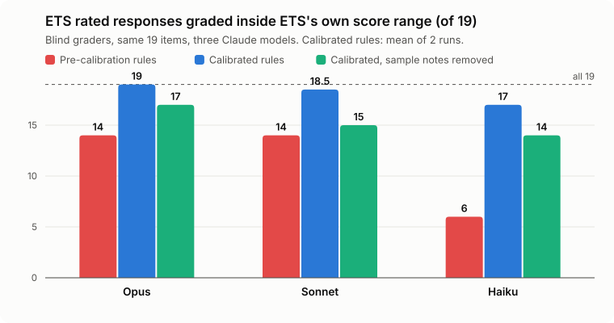
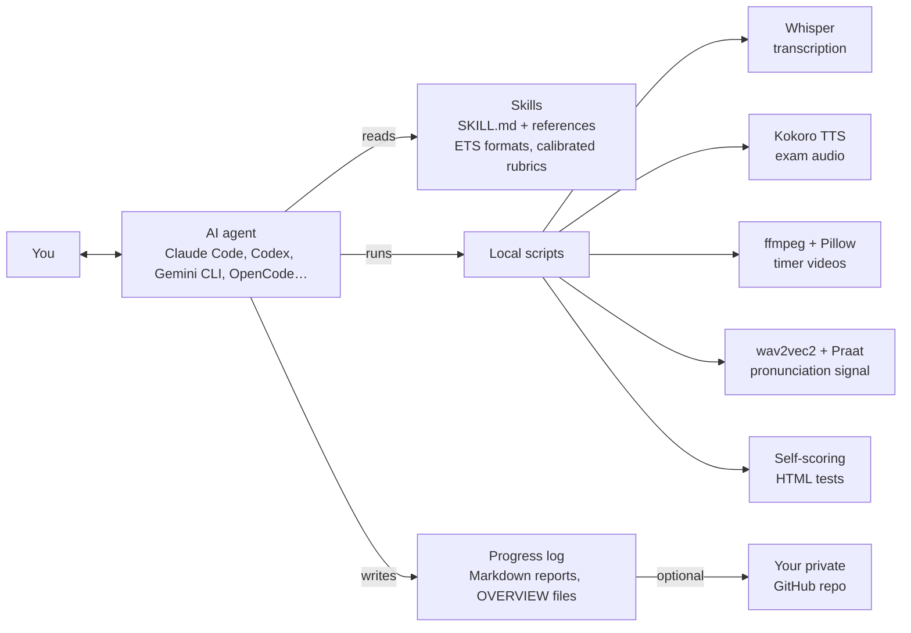

# TOEFL Coach: an AI exam coach with a grader calibrated against ETS

[](LICENSE)
[](https://agentskills.io)
[](#use-it-with-any-model)
[](#how-it-works)

A personal coach for the **TOEFL iBT** (the English exam many universities require, in its format since January 2026) that runs inside an AI agent such as Claude Code. It builds exam-faithful practice (audio, timer videos, self-scoring tests), grades your speaking and writing, and keeps a log of your progress.

Most AI tutors just *say* a score. This one was **checked against ETS's own rated answers**, blind, and then against a real exam.

| | |
|---|---|
| 🎯 **Real exam, author's result** | **Speaking 6 / 6**, **Writing 5.5 / 6**, both inside the range the coach forecast |
| 🧪 **Blind calibration on ETS-rated answers** | held-out set: **8/11 → 10/11** inside ETS's score range, **11/11** within one point |
| 🔁 **Same rules, three model sizes** | inside ETS's range: Opus **14 → 19**, Sonnet **14 → 18.5**, Haiku **6 → 17** of 19 |
| 📏 **Repeatable** | test-retest QWK **0.99** (Opus, Sonnet), **0.88** (Haiku) |

<picture>
  <source media="(prefers-color-scheme: dark)" srcset="evaluation/calibration-by-model-dark.svg">
  
</picture>

---

## What it does

You talk to the coach in plain language ("give me a speaking test", "grade this"), and it does the rest.

| Part of the exam | What you get |
|---|---|
| 🎙️ **Speaking** | Full Speaking sections as a **video with the exam's timers and beeps** (Listen and Repeat + Take an Interview). You record yourself on your phone, send the file, and get every answer **transcribed and graded**: transcript, two scores, what works, what costs points, a corrections table and a model answer that keeps your own ideas. |
| 🗣️ **Pronunciation** | A separate signal from a local phoneme recognizer and Praat: which sounds you substitute (*th*, short *i*, final consonants…), how flat your intonation is, and where you pause mid-phrase, compared with ETS's top-rated speakers. It never changes a score. |
| 🎧 **Listening** | Self-scoring test pages: each recording plays once, questions appear afterwards, two stages, a band estimate at the end. |
| 📖 **Reading** | Self-scoring test pages with module timers, all ETS task types (Complete the Words, Read in Daily Life, academic passages) and a band estimate. |
| ✍️ **Writing** | Interactive tests with the exam's timers (Build a Sentence scores itself), plus grading of Emails and Academic Discussion posts: an error log, the biggest wins and a level-5 rewrite. |
| 📈 **Progress** | Every grade lands in Markdown files: one report per task and an overview with your averages, band estimate, most frequent errors and **what to focus on next**. The coach reads that focus before your next task. |
| 📚 **Your story bank** | Formulas for each question type and a bank of short, true stories from your own answers, so you always have a concrete example ready. Never invented, never memorized scripts. |

**Two scores for every answer.** The **ETS estimate** predicts what an ETS rater would give. The **strict estimate** is deliberately harsher and points at what still separates a good answer from an excellent one. Use the first to know where you stand and the second to know what to fix.

**Ready to use, out of the box:** 2 full Speaking sections and 2 interview sets as timer videos, 2 Listening tests (one standard, one harder), and Writing prompts. Everything else is generated on demand, in the official formats.

> Everything follows ETS's published task formats ([`ets-format.md`](.claude/skills/toefl-coach/references/ets-format.md)). The coach never invents a task type.

---

## Results: one learner, one real exam
The author prepared with this coach (logged practice from 18 October to 10 November 2026) and then took the real TOEFL iBT:

| Section | Real score | The coach's forecast before the exam |
|---|---|---|
| **Speaking** | **6 / 6** (C2) | ETS estimate 5.5–6; strict estimate 4.5–5.5 |
| **Writing** | **5.5 / 6** (C1) | ETS estimate 5.5–6.0; strict estimate 4.0–5.0 |

**What changed during practice** (from the logs): 67 graded interview answers, 9 full Speaking sections (4 of them official ETS material), 21 Writing responses and 8 Build a Sentence sets.
- **Speaking pace** went from about 110 to 145–160 words per minute.
- **Listen and Repeat** went from 31/35 in the first section to 33–34/35 on unseen official sections.
- **Writing** went from a first Email at 4 to mostly 5s on Emails and Academic Discussions; Build a Sentence: 72 of 74 correct.
- **The recurring errors became a checklist** (answer the exact question first, one concrete example, a closing sentence, articles, first-language calques), and each report names the focus for the next task.

**The calibration, checked by the real exam.** Before the blind calibration, the Writing rules forecast **4.0–5.0**. After it, **5.5–6.0**. The real score was **5.5**. For Speaking, the forecast was already right (5.5–6) and the real score was **6**.

One learner and two section scores make a sanity check, not a study. The controlled evidence is below.

---

## How the grader was calibrated

**The problem.** An LLM reading a rubric literally is a biased judge. "Almost no errors" becomes "every error costs a point", so top answers get 3s and 4s. It can also drift the other way when it knows the learner. Without ground truth, you cannot tell which.

**The ground truth.** ETS publishes rated responses: interview answers with audio, emails and discussion posts, from top level down to memorized filler that scores 1–2. Nineteen of them, plus three synthetic controls for the middle of the scale, became the test set. Spoken answers went through the same local pipeline as a learner's recording (Whisper transcript, measured pauses and pace).

**The protocol** (the author's design; Claude Code carried it out):
1. **A serving agent blinds the data.** Random IDs, shuffled order, and the official scores and rater comments go into a separate key file.
2. **Fresh grader agents see one file only:** the rules plus the anonymized responses, with a read-only tool. Every run reports which files it opened.
3. **Calibration set and held-out set.** The rules were rewritten only from errors on the calibration set, then tested by a new blind grader on 11 responses the rules had never seen: **8/11 → 10/11** inside ETS's range, **11/11** within one point, bias **−0.36 → −0.09**.
4. **The strict lens was frozen.** Only the ETS-prediction rules changed. The training rubric stayed as harsh as before, so the calibration could not quietly make the coach softer.
5. **Noise was measured, not assumed.** Repeated blind runs, and a blind re-grade of all 59 of the author's own answers by an agent that never saw the earlier scores: Listen and Repeat matched 28/28, the ETS estimate 25/31 (every difference ±1, all on answers already labelled borderline). The re-grade also exposed a bias: the coach's first strict scores had been half a point **too kind** when it knew the learner. So scores are reported with *borderline* labels, and important checks are run blind.

**Model transfer and an ablation** ([full evaluation](evaluation/README.md)). The same 19 responses were graded blind by **Claude Opus, Sonnet and Haiku** under three rule sets: before calibration, calibrated, and calibrated with every note about the calibration samples removed.

| Model | Before | Calibrated (2 runs) | Without sample notes | Bias before → after | Test-retest |
|---|---|---|---|---|---|
| Opus | 14 / 19 | **19 / 19** | 17 / 19 | −0.32 → 0.00 | QWK 0.99 |
| Sonnet | 14 / 19 | **18.5 / 19** | 15 / 19 | −0.32 → −0.03 | QWK 0.99 |
| Haiku | 6 / 19 | **17 / 19** | 14 / 19 | −0.95 → −0.11 | QWK 0.88 |

- The uncalibrated rubric was **too harsh, and more so for smaller models**: Haiku gave none of the 12 top-rated responses a 5.
- Calibration **removed the bias without inflating**: the weak responses stayed low in 59 of 60 gradings.
- Rules fitted with one model **transfer**: Sonnet matches Opus on 18 of 19 items (QWK 0.98).
- **Honest caveat:** on these 19 items the calibrated rules are in-sample. The ablation shows how much of the gain comes from general principles rather than notes about specific samples, and the held-out step and the real exam are the out-of-sample checks.

---

## Quick start (no technical background needed)

### What you need
- A computer. A **Mac with Apple Silicon (M1 or newer)** works best. Windows (through WSL) and Linux work too, but are less tested.
- An AI agent. The tested one is **Claude Code**, which comes with a Claude Pro or Max plan. [Other agents and local models](#use-it-with-any-model) work as well.
- About **4 GB** of free disk space for the speech models.

### 1. Get your own copy
- **Easiest:** click **Use this template → Create a new repository**, choose **Private** (your recordings and answers will live there), then download it with **Code → Download ZIP** and unzip it.
- **With git:** `git clone https://github.com/<your-name>/<your-repo>.git`

### 2. Open it in your AI agent
With Claude Code: install the [Claude desktop app](https://claude.com/download), open the **Code** tab and select the folder. The agent reads the instructions in the folder by itself.

### 3. Let the agent set it up
Type:
> Set up this project for me.

It installs the two tools it needs (`uv` and `ffmpeg`) and the local speech models, and asks your permission for each step. If you prefer to do it yourself on a Mac:
```bash
brew install uv ffmpeg
bash .claude/skills/toefl-coach/scripts/setup_env.sh
```

### 4. Tell it about yourself
Open `CLAUDE.md` and edit **Learner settings**, or just tell the agent, e.g.:
> My first language is Spanish. Give me feedback in Spanish.

### 5. Start practising
| You want | Type |
|---|---|
| a full Speaking section (about 7 min, with a timer video) | *give me a full speaking section* |
| a short interview set | *give me a new interview set with a video* |
| only Listen and Repeat | *give me a listen and repeat drill* |
| your recording graded | *grade this* + drag the `.m4a` file into the chat |
| a Listening or Reading test | *give me a listening test* / *give me a reading test* |
| a Writing test with timers | *give me a writing test* |
| your essay or email graded | paste the task and your text, then *grade this* |
| advice | *how should I structure question 3?* |
| your progress | *what are my most frequent mistakes?* |

**How a Speaking practice works:** play the video on your computer, record yourself on your phone from start to finish, and send the recording. The coach splits it by the beeps, grades every answer and writes the report.

---

## Use it with any model

Nothing here is locked to one provider. The behaviour is plain Markdown in the open [Agent Skills](https://agentskills.io) format (`SKILL.md` files), plus `CLAUDE.md` and [`AGENTS.md`](AGENTS.md), and all audio, video and measurement work is done by local Python scripts.

| Setup | How | Notes |
|---|---|---|
| **Claude Code** (tested) | Desktop app (Code tab) or terminal; open the folder. | The grading rules were calibrated with Claude models (see the table above). |
| **OpenAI Codex CLI** | `npm install -g @openai/codex`, then run `codex` in the folder. | Reads `AGENTS.md`. If your version looks for skills in `.agents/skills/`, link them: `mkdir -p .agents && ln -s ../.claude/skills .agents/skills` |
| **Gemini CLI** | `npm install -g @google/gemini-cli`, then run `gemini` in the folder. | Reads `GEMINI.md` by default: run `cp AGENTS.md GEMINI.md`, or point its context-file setting at `AGENTS.md`. |
| **GitHub Copilot, Cursor** | Open the folder in VS Code (agent mode) or Cursor. | Both read `AGENTS.md`; recent versions also load Agent Skills. |
| **OpenCode** (any provider) | Install from [opencode.ai](https://opencode.ai), choose a provider, run `opencode` in the folder. | Loads `.claude/skills/` and `AGENTS.md` directly. |
| **Local models** (nothing leaves your computer) | Install [Ollama](https://ollama.com) or LM Studio, download a model, and select it in OpenCode. | Use the largest instruction-following model your machine can run: holistic grading and long skill files are hard for small models. |
| **No agent at all** | Use the ready-made videos and tests in the folder; for grading, paste the transcript and [`speaking-grading.md`](.claude/skills/toefl-coach/references/speaking-grading.md) (or the writing rubrics) into any chat model. | On claude.ai you can upload `claude-ai/*.skill` instead. |

**Before you trust scores from another model,** check it the same way: [`evaluation/`](evaluation/README.md) has the protocol, the data format and a script that computes the metrics. The evaluation above shows that a smaller model of the same family stays close but noisier, so expect about ±1 on borderline answers.

Folder names and setup steps of these tools change often; when in doubt, check the tool's own documentation.

---

## How it works


- **Agent Skills** (`.claude/skills/`): `toefl-coach` (tasks, tests, speaking grading, logging) and `toefl-writing-grader` (writing grading), each with instructions, reference files and scripts.
- **Local speech pipeline** (MLX on Apple Silicon): Whisper large-v3-turbo transcription; pause, pace and over-time measurement with `ffmpeg`; natural-voice exam audio with Kokoro, every line checked back with Whisper; timer videos with Pillow and `ffmpeg`; a wav2vec2 phoneme recognizer aligned with the expected pronunciation, plus Praat measures.
- **Self-scoring test pages**: single HTML files with the test data embedded, module timers, unscored items and a result block to paste back.
- **Privacy:** audio is processed on your computer. Transcripts and texts go to whichever model you use; with a local model, nothing leaves your machine.

## What's in the folder
```
CLAUDE.md, AGENTS.md          instructions and your learner settings (any agent reads them)
.claude/skills/               the two skills: instructions, references, scripts
speaking/  listening/  reading/  writing/   your practice log (starts empty) and practice tasks
speaking-audio/  listening/tests/            ready-made timer videos and Listening tests
evaluation/                   the model comparison: data, metrics script, chart
claude-ai/                    the skills packaged for upload to claude.ai
```

## Disclaimer
TOEFL and TOEFL iBT are registered trademarks of ETS. This project is not affiliated with, endorsed or approved by ETS. It contains no ETS test content: the reference files summarize ETS's published format descriptions and scoring guides in the author's own words, with a few short quotations (on-screen instructions, single phrases from rated sample responses) for reference. The calibration used the author's own copy of the *Official Guide*, which is not distributed here. Everything else (tasks, audio, videos) is original. Practice simulation, not an official ETS product.

Built by the author with Claude Code as the implementation agent. The code is MIT-licensed ([LICENSE](LICENSE)); the speech models it downloads (Whisper, Kokoro, wav2vec2) come with their own licenses.
