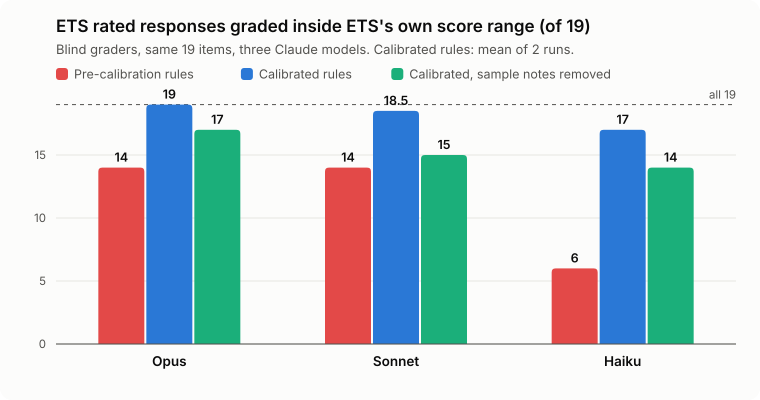
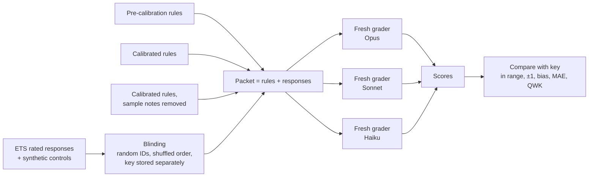

# Evaluation: does the calibrated grader agree with ETS, and does it transfer across models?

An LLM can grade an essay; the question is whether its numbers mean anything. This folder measures that against the only ground truth available: responses that **ETS itself rated** in its *Official Guide to the TOEFL iBT Test* (2026) and *Test Overview*.

<picture>
  <source media="(prefers-color-scheme: dark)" srcset="calibration-by-model-dark.svg">
  
</picture>

## Headline
| Model | Pre-calibration rules | Calibrated rules (mean of 2 runs) | Calibrated, sample notes removed | Bias before → after | Test-retest (calibrated) |
|---|---|---|---|---|---|
| Claude Opus 5.5 | 14 / 19 | **19 / 19** | 17 / 19 | −0.32 → **0.00** | 18/19 exact, QWK 0.99 |
| Claude Sonnet 5.5 | 14 / 19 | **18.5 / 19** | 15 / 19 | −0.32 → **−0.03** | 18/19 exact, QWK 0.99 |
| Claude Haiku 5.5 | 6 / 19 | **17 / 19** | 14 / 19 | −0.95 → **−0.11** | 13/19 exact, QWK 0.88 |

*In range* = the score falls inside ETS's level for the item. *Bias* = mean signed error against the range bounds (negative = harsher than ETS). Within ±1 point: 18, 18 and 14 of 19 before calibration; **19 of 19 for every model after**.

**What it shows**
1. **The uncalibrated rubric was systematically too harsh,** and the weaker the model, the harsher: Haiku gave none of the 12 responses ETS rated 5 a 5. This is the classic failure of an LLM judge reading a rubric literally ("almost no errors" → any error costs a point).
2. **Calibration removes the bias without inflating scores.** The five weak responses (two content-free or memorized fragments ETS scores 1–2, three synthetic controls at 2–4) stayed inside their low ranges in 59 of 60 gradings; the one miss was a 1 instead of 2–3, i.e. harsher, not kinder. The rules did not just learn "give a 5".
3. **The rules transfer down the model ladder.** Rules fitted with Opus graders work almost unchanged for Sonnet (18 of 19 identical scores to Opus, QWK 0.98) and lift Haiku from 6 to 17 of 19; Haiku stays noisier between runs (QWK 0.88).
4. **Ablation: most of the gain survives without the sample notes.** The calibrated rules contain a short description of the very samples they were fitted on. Removing every such description keeps a large part of the improvement for Opus (14 → 17) and Haiku (6 → 14), but less for Sonnet (14 → 15). So the general principles do carry over, and part of the in-sample score comes from the sample notes, which is exactly why the original calibration was validated on a held-out set (below).

Breakdown by task (items in range, pre → calibrated): interview 10 → 10 (Opus), 9 → 9.5 (Sonnet), 2 → 8.5 (Haiku) of 10; email 2 → 4, 2 → 4, 1 → 4 of 4; academic discussion 2 → 5, 3 → 5, 3 → 4.5 of 5. Writing is where the old rubric failed most.

## The ground truth: 19 responses
No ETS text is reproduced here; items are identified by source.

| Source | Task | ETS level |
|---|---|---|
| Official Guide ch. 5, tracks 49–52 (4 answers) | Take an Interview | 5 (stated: "fully successful") |
| Official Guide practice test, tracks 91–94 (4 answers) | Take an Interview | 5 (described in level-5 terms) |
| Official Guide p. 209 | Email | 5 (stated) |
| Official Guide p. 218 | Academic Discussion | 5 (level-5 wording) |
| Official Guide p. 333 | Email | 5 (stated) |
| Official Guide p. 334 | Academic Discussion | 5 (stated) |
| Test Overview "Sample High-Level Response" | Email | 4–5 (high level, no number) |
| Test Overview "Sample High-Level Response" (~80 words) | Academic Discussion | 4–5 (high level, no number) |
| Official Guide p. 216, two fragments (content-free, memorized) | Academic Discussion | 1–2 (stated) |
| Synthetic controls (weak 30-word answer; frequent basic errors; email with a missing point) | Interview, Interview, Email | 2–3, 3–4, 2–3 (by the scoring guides) |

Spoken answers went through the same pipeline as a learner's recordings: the ETS audio was transcribed locally with Whisper, and pace, pauses and fillers were measured with `answer_stats.py`. The grader sees our transcript and stats, never ETS's transcript or comments.

## Protocol

- **Blind by construction.** Each grader is a fresh agent that may use only a file-read tool on one packet: the rules plus the responses under random IDs. The key (source and ETS level) lives in a separate file it never sees. Every run reported the files it read; all twelve read only their packet, with one or two read calls.
- **Three rule sets.** The rules before calibration (the repository's state of 23 October 2026), the calibrated rules (the current skill files), and an ablation of the calibrated rules with every description of the calibration samples removed.
- **Three models, twelve runs.** Claude Opus 5.5, Sonnet 5.5 and Haiku 5.5, as Claude Code sub-agents. Calibrated rules: two runs per model with different item orders, for test-retest reliability. Pre-calibration and ablation: one run each.
- **Metrics:** items inside the ETS range; within one point; mean signed error and mean absolute error against the range bounds; test-retest exact agreement and quadratic weighted kappa (QWK), the agreement statistic used for automated essay scoring. Run `python3 analyze.py` to recompute everything from [`results.json`](results.json).

## How the calibration itself was done (24 October 2026)
The calibrated rules come from a separate, earlier experiment with the same blinding, designed so the result could not be talked into existence:
1. A serving agent extracted the ETS samples, ran the audio through the pipeline and wrote blinded packets; the official scores and rater comments went into a key file.
2. The 19 items were split into a **calibration set (8)** and a **held-out set (11)**.
3. Fresh blind graders scored the calibration set with the old rules. Only the ETS-prediction rules were rewritten from the errors; the strict "training" rubric was frozen and left untouched.
4. A new blind grader applied the rewritten rules to the **held-out set**, which no rule had seen: inside ETS's range went from **8/11 to 10/11**, and within ±1 from 10/11 to **11/11** (bias −0.36 → −0.09).

Details: [`ets-calibration-report.md`](../.claude/skills/toefl-coach/references/ets-calibration-report.md).

## Real-world check
The author used the calibrated coach to prepare and then took the real test: **Speaking 6/6 and Writing 5.5/6**. The calibrated forecasts before the test were 5.5–6 for Speaking and 5.5–6.0 for Writing; the pre-calibration Writing rules had pointed to 4.0–5.0. One learner, two section scores: a sanity check, not a study.

## Per-item scores
Order: pre-calibration, calibrated (two runs), calibrated without sample notes.

| Source | ETS | Opus | Sonnet | Haiku |
|---|---|---|---|---|
| Guide ch. 5, track 49 | 5 | 5; 5/5; 5 | 4; 5/5; 4 | 4; 5/4; 4 |
| Guide ch. 5, track 50 | 5 | 5; 5/5; 5 | 5; 5/5; 5 | 4; 5/5; 4 |
| Guide ch. 5, track 51 | 5 | 5; 5/5; 5 | 5; 5/5; 5 | 4; 5/5; 5 |
| Guide ch. 5, track 52 | 5 | 5; 5/5; 5 | 5; 5/5; 5 | 4; 5/5; 5 |
| Guide practice test, track 91 | 5 | 5; 5/5; 5 | 5; 5/5; 5 | 4; 5/5; 5 |
| Guide practice test, track 92 | 5 | 5; 5/5; 5 | 5; 5/5; 5 | 3; 5/4; 5 |
| Guide practice test, track 93 | 5 | 5; 5/5; 5 | 5; 5/5; 5 | 4; 5/5; 5 |
| Guide practice test, track 94 | 5 | 5; 5/5; 5 | 5; 5/5; 4 | 3; 5/4; 5 |
| Guide p. 209 (email) | 5 | 4; 5/5; 4 | 4; 5/5; 4 | 3; 5/5; 4 |
| Guide p. 218 (academic discussion) | 5 | 4; 5/5; 5 | 4; 5/5; 5 | 4; 5/5; 5 |
| Guide p. 333 (email) | 5 | 4; 5/5; 4 | 4; 5/5; 5 | 3; 5/5; 4 |
| Guide p. 334 (academic discussion) | 5 | 3; 5/5; 5 | 3; 5/5; 4 | 3; 5/4; 4 |
| Overview high-level email | 4–5 | 4; 5/5; 5 | 4; 5/5; 4 | 3; 4/4; 4 |
| Overview high-level discussion | 4–5 | 3; 4/4; 4 | 4; 4/4; 4 | 4; 5/5; 4 |
| Guide p. 216, content-free fragment | 1–2 | 2; 1/1; 1 | 2; 1/1; 2 | 1; 1/2; 2 |
| Guide p. 216, memorized text | 1–2 | 2; 2/1; 1 | 2; 2/2; 2 | 2; 2/2; 2 |
| Control: weak, choppy, ~30 words | 2–3 | 2; 2/2; 2 | 2; 2/1; 2 | 2; 3/3; 3 |
| Control: frequent basic errors | 3–4 | 3; 3/3; 3 | 3; 3/3; 3 | 3; 4/4; 3 |
| Control: email missing a point | 2–3 | 2; 2/2; 2 | 2; 3/3; 3 | 2; 3/2; 2 |

## Limitations
- **In-sample.** The calibrated rules were fitted on these 19 items; this experiment measures fit and transfer across models, not generalization. The out-of-sample evidence is the held-out step above (11 items) and the real-test check.
- **Small n and a top-heavy ground truth.** ETS publishes mostly top-level samples and a few very weak ones; the 3/4 boundary rests on synthetic controls, written by the author's setup.
- **Some reference levels are inferred** from the rater's wording (practice-test interviews, the Overview samples).
- **Single runs** for the pre-calibration and ablation conditions; LLM graders vary by about ±1 on borderline responses.
- **Transcripts, not audio.** Graders read Whisper transcripts with measured pauses; they cannot hear pronunciation.

## Reproducing it
You need your own copy of the Official Guide (2026); ETS material is not distributed here. Build blinded packets from the items listed above (rules + our transcript and stats, random IDs, a separate key), run one fresh grader per packet with read-only access to that file, save the scores in the format of `results.json`, and run `python3 analyze.py`.
